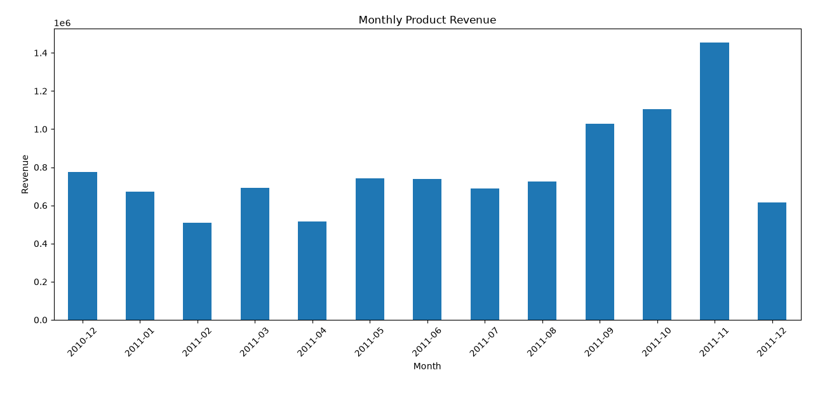
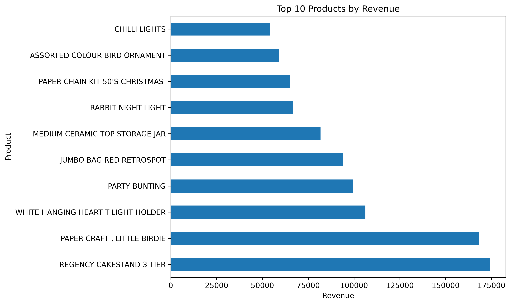
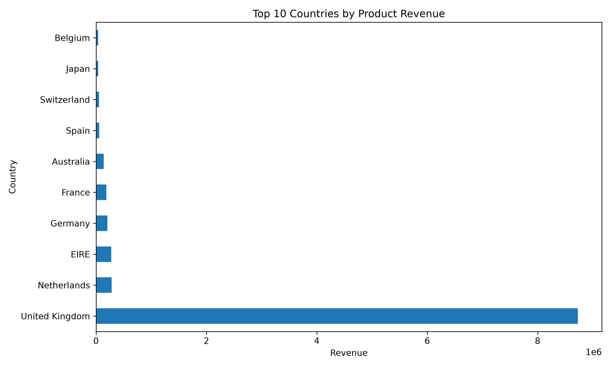

# Retail Sales Analysis

## Project Overview
This project analyzes online retail sales data using Python to identify sales trends, top-performing products, and leading markets.

## Data Cleaning
- Removed duplicate records.
- Excluded cancelled transactions from ordinary sales analysis.
- Excluded rows with non-positive quantities or prices.
- Excluded selected non-product transactions, including postage, fees, and accounting adjustments.

## Key Findings
- **Total product revenue:** 10,255,184.18
- **Top product by revenue:** REGENCY CAKESTAND 3 TIER — 174,156.54
- **Best-performing month:** November 2011 — 1,453,295.98
- **Top country:** United Kingdom — 8,726,832.53

## Tools Used
- Python
- Pandas
- Matplotlib
- PyCharm

## Visualizations
Charts showing monthly revenue and the top 10 products by revenue will be included here.

### Monthly Revenue

### Top 10 Products by Revenue

### Top 10 Countries by Revenue

