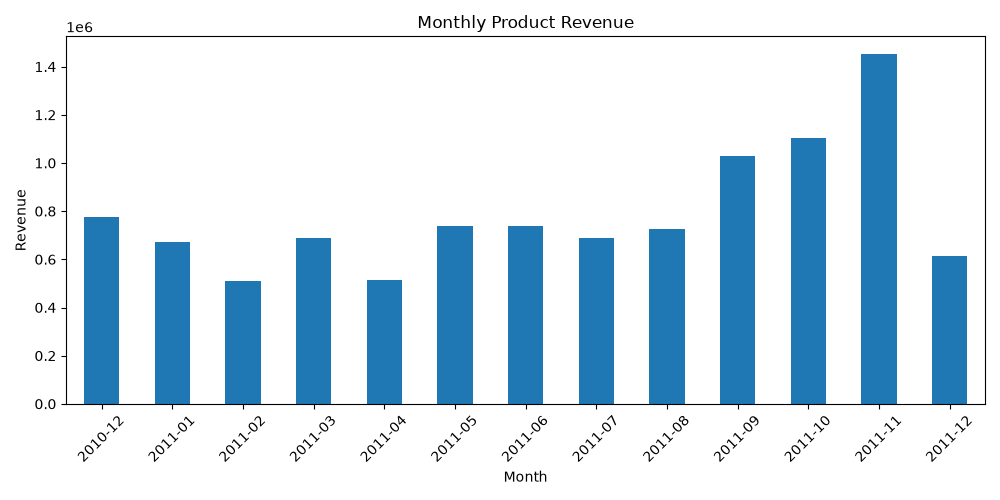
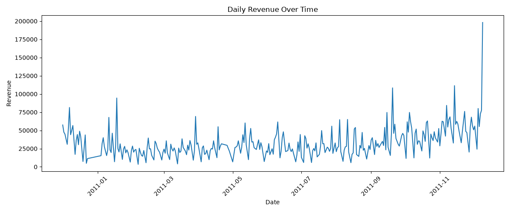
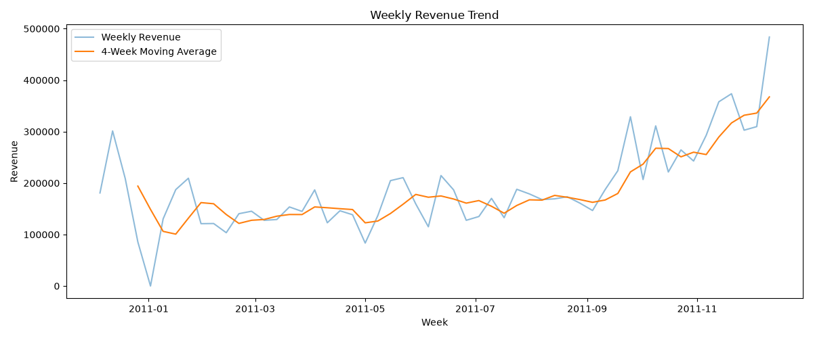
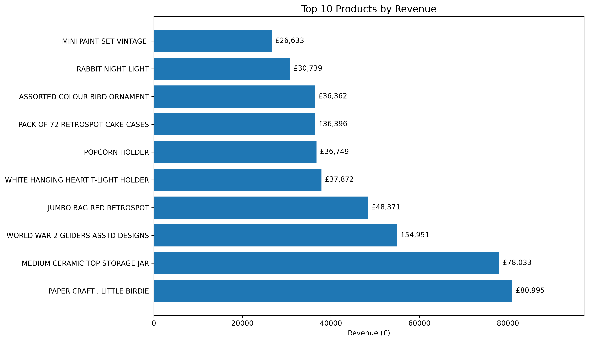
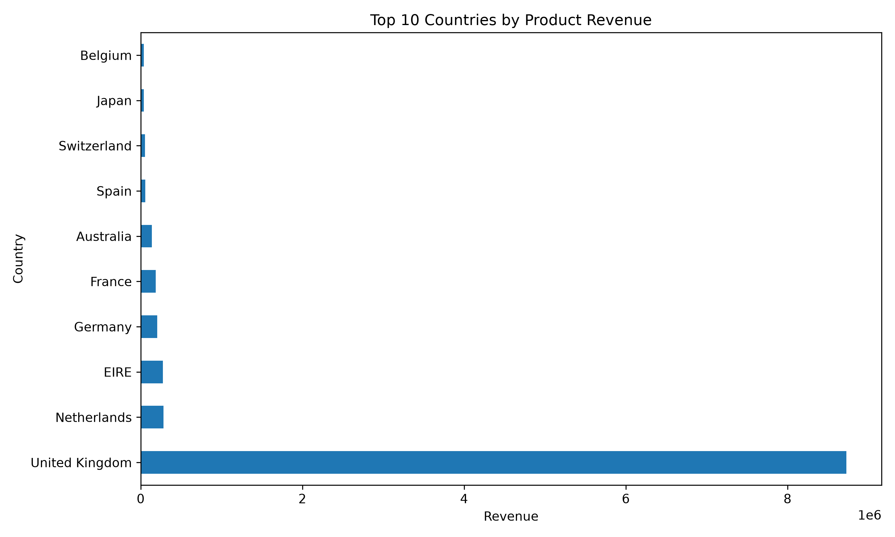
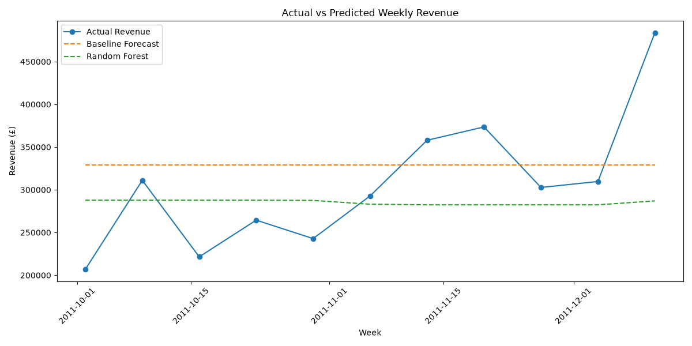

# Retail Sales Analysis

## Overview
This project explores online retail sales data to understand revenue performance across products, 
months, and countries. It uses Python and SQL for data cleaning, analysis, visualization, 
and weekly revenue forecasting.

## Tools
- Python
- Pandas
- NumPy
- Matplotlib
- SQLite
- Scikit-learn

## Data Cleaning
- Removed duplicate records.
- Excluded cancelled transactions.
- Removed records with non-positive quantities or prices.
- Excluded selected non-product transactions.
- Calculated revenue using quantity multiplied by unit price.

## Key Findings

- Total product revenue: £10,255,184.18
- Top product: Regency Cakestand 3 Tier (£174,156.54)
- Best-performing month: November 2011 (£1,453,295.98)
- Top country: United Kingdom (£8,726,832.53)

## Sales Analysis

### Monthly Revenue


### Daily Revenue


### Weekly Revenue


### Top 10 Products


### Top 10 Countries


## SQL Analysis

Used SQLite to answer three business questions:

1. Which products generate the most revenue?
2. Which month has the highest revenue?
3. Which countries generate the most revenue?

SQL techniques included aggregation, GROUP BY, ORDER BY, date functions, and JOINs.

## Revenue Forecasting

Compared a baseline model with a Random Forest Regressor to forecast weekly revenue. 
Model performance was evaluated using MAE and RMSE.



## Project Structure

```text
retail-sales-project/
├── outputs/
├── sql/
│   └── sql_analysis.py
├── main.py
├── forecasting.py
├── weekly_revenue.csv
├── requirements.txt
└── README.md
```

## How to Run

Install the required libraries:

```bash
pip install -r requirements.txt
```

Place `Retail_data.csv` in the project folder, then run:

```bash
python main.py
python sql/sql_analysis.py
python forecasting.py
```
Dataset: [UCI Online Retail Dataset](https://archive.ics.uci.edu/dataset/352/online+retail)

---

Note: Revenue figures are based on the project's cleaning rules and may differ from official accounting figures. 
Forecasting results are exploratory.
